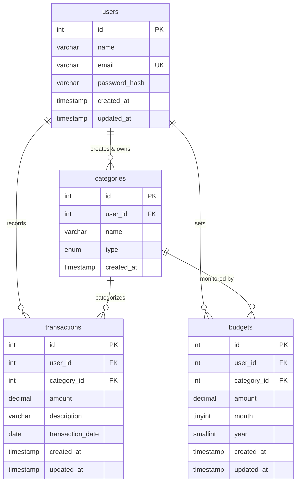

# Expense Tracker - Database Documentation (Phase 2)

This document provides complete documentation of the MySQL database design, table relationships, integrity constraints, and setup instructions for the Expense Tracker application.

---

## 1. Entity-Relationship (ER) Diagram



---

## 2. Table Specifications & Column Details

### A. `users`
Represents registered users of the expense tracker.
- **`id`** (`INT`, PK, AUTO_INCREMENT): Unique identifier.
- **`name`** (`VARCHAR(100)`, NOT NULL): Full name of the user.
- **`email`** (`VARCHAR(150)`, NOT NULL, UNIQUE): Unique email used for authentication.
- **`password_hash`** (`VARCHAR(255)`, NOT NULL): Secure hashed password (bcrypt).
- **`created_at`** (`TIMESTAMP`, DEFAULT CURRENT_TIMESTAMP): Account registration timestamp.
- **`updated_at`** (`TIMESTAMP`, DEFAULT CURRENT_TIMESTAMP ON UPDATE CURRENT_TIMESTAMP): Automatic update timestamp.

### B. `categories`
Stores classification labels for income and expense transactions.
- **`id`** (`INT`, PK, AUTO_INCREMENT): Unique identifier.
- **`user_id`** (`INT`, NOT NULL): Foreign key referencing `users.id`.
- **`name`** (`VARCHAR(100)`, NOT NULL): Category name (e.g. Salary, Rent, Food).
- **`type`** (`ENUM('INCOME', 'EXPENSE')`, NOT NULL): Whether this category represents earnings or spending.
- **`created_at`** (`TIMESTAMP`, DEFAULT CURRENT_TIMESTAMP): Timestamp created.
- **Constraints & Keys:**
  - `UNIQUE KEY uk_categories_user_name_type (user_id, name, type)`: Prevents duplicate category names for the same user under the same classification.
  - `UNIQUE KEY uk_categories_id_user_id (id, user_id)`: Enables composite foreign key enforcement from downstream tables.
  - `KEY idx_categories_user_id (user_id)`: Quick retrieval of categories belonging to a user.

### C. `transactions`
Records each individual financial event.
- **`id`** (`INT`, PK, AUTO_INCREMENT): Unique identifier.
- **`user_id`** (`INT`, NOT NULL): Foreign key referencing `users.id`.
- **`category_id`** (`INT`, NOT NULL): Category under which this transaction is classified.
- **`amount`** (`DECIMAL(12,2)`, NOT NULL): Monetary amount. Checked to be `> 0`.
- **`description`** (`VARCHAR(255)`, NULL): Optional note/memo.
- **`transaction_date`** (`DATE`, NOT NULL): Date the transaction took place.
- **`created_at`** (`TIMESTAMP`, DEFAULT CURRENT_TIMESTAMP): Creation timestamp.
- **`updated_at`** (`TIMESTAMP`, DEFAULT CURRENT_TIMESTAMP ON UPDATE CURRENT_TIMESTAMP): Automatic update timestamp.
- **Constraints & Keys:**
  - `CONSTRAINT chk_transactions_amount CHECK (amount > 0)`.
  - Composite Foreign Key `FOREIGN KEY (category_id, user_id) REFERENCES categories(id, user_id)`: Guarantees that a transaction can only link to a category owned by the exact same user.
  - `KEY idx_transactions_user_date (user_id, transaction_date)`: Accelerates date-range queries for reports and statements.
  - `KEY idx_transactions_user_category (user_id, category_id)`: Accelerates category-based aggregations.

### D. `budgets`
Specifies monthly spending caps for expense categories.
- **`id`** (`INT`, PK, AUTO_INCREMENT): Unique identifier.
- **`user_id`** (`INT`, NOT NULL): Foreign key referencing `users.id`.
- **`category_id`** (`INT`, NOT NULL): Expense category associated with the budget.
- **`amount`** (`DECIMAL(12,2)`, NOT NULL): Budget cap amount. Checked to be `> 0`.
- **`month`** (`TINYINT`, NOT NULL): Calendar month (`CHECK (month BETWEEN 1 AND 12)`).
- **`year`** (`SMALLINT`, NOT NULL): Calendar year (`CHECK (year BETWEEN 2000 AND 2100)`).
- **`created_at`** (`TIMESTAMP`, DEFAULT CURRENT_TIMESTAMP): Creation timestamp.
- **`updated_at`** (`TIMESTAMP`, DEFAULT CURRENT_TIMESTAMP ON UPDATE CURRENT_TIMESTAMP): Automatic update timestamp.
- **Constraints & Keys:**
  - `UNIQUE KEY uk_budgets_user_cat_month_year (user_id, category_id, month, year)`: Guarantees exactly one budget per user/category/month/year combination.
  - Composite Foreign Key `FOREIGN KEY (category_id, user_id) REFERENCES categories(id, user_id)`: Guarantees budget category ownership.
  - `KEY idx_budgets_user_year_month (user_id, year, month)`: Speeds up monthly dashboard budget vs. actual calculations.

---

## 3. Architectural Design Decisions

### A. Why `DECIMAL(12,2)` instead of `FLOAT` or `DOUBLE`
In financial applications, binary floating-point numbers (`FLOAT`, `DOUBLE`) introduce IEEE 754 precision rounding errors (such as `0.1 + 0.2 = 0.30000000000000004`). 
`DECIMAL(12,2)` stores numbers as fixed-point exact numeric strings, supporting values up to `9,999,999,999.99` with absolute cents/paise precision.

### B. Deriving Transaction Type from Category Type
Rather than storing a redundant `type` column in `transactions`, the transaction type (`INCOME` or `EXPENSE`) is directly derived via its relationship to `categories.type`.
- Eliminates data synchronization anomalies (e.g. prevents marking a "Salary" category as an "EXPENSE" transaction).
- Follows Third Normal Form (3NF) principles.

### C. User Data Isolation & Cross-Tenant Protection
To prevent User A from creating transactions or budgets using User B's categories:
1. `categories` defines a composite unique index on `(id, user_id)`.
2. Both `transactions` and `budgets` define a **composite foreign key**:
   ```sql
   FOREIGN KEY (`category_id`, `user_id`)
     REFERENCES `categories` (`id`, `user_id`)
     ON DELETE RESTRICT
     ON UPDATE CASCADE
   ```
3. If an API request attempts to assign a category with ID `5` (owned by User 1) to a transaction with `user_id = 2`, the database engine immediately rejects the query with a foreign key violation.

### D. Foreign Key Rules (`ON DELETE RESTRICT`, `ON UPDATE CASCADE`)
- **`ON DELETE RESTRICT`**: Prevents accidental deletion of users or categories that have active transaction or budget history. Cascading deletes would risk irreversibly wiping past financial records.
- **`ON UPDATE CASCADE`**: Ensures consistent ID propagation if user or category primary keys change.

### E. Storage Engine & Character Set
- **Engine**: `InnoDB` supports ACID transactions, row-level locking, and foreign key integrity constraints.
- **Charset & Collation**: `utf8mb4` with `utf8mb4_unicode_ci` provides full Unicode coverage (including multi-byte characters and international currency symbols).

---

## 4. Limitations & Application-Level Enforcements

- **Budget Category Type Enforcement**: Standard SQL foreign keys ensure category ownership but cannot conditionally assert `categories.type = 'EXPENSE'` across foreign tables in MySQL 8.0 without triggers. The backend service layer (Phase 3/4) must validate that categories assigned to budgets are of type `'EXPENSE'`.

---

## 5. Database Setup & Execution Instructions

### Step 1: Configure Credentials in `server/.env`
Ensure your local `server/.env` file contains your MySQL credentials:
```env
PORT=5001
NODE_ENV=development

DB_HOST=localhost
DB_USER=root
DB_PASSWORD=your_actual_mysql_password
DB_NAME=expense_tracker
DB_PORT=3306

JWT_SECRET=your_jwt_secret_key_here
JWT_EXPIRES_IN=24h
CLIENT_URL=http://localhost:5173
```

### Step 2: Apply the Database Schema
Execute the SQL schema using MySQL CLI:
```powershell
& "C:\Program Files\MySQL\MySQL Server 8.0\bin\mysql.exe" -u root -p < server\database\schema.sql
```
*(Enter your MySQL root password when prompted)*

### Step 3: Test the Database Connection
From the `server` directory:
```powershell
cd D:\Auspify\expense-tracker\server
npm run test:db
```
